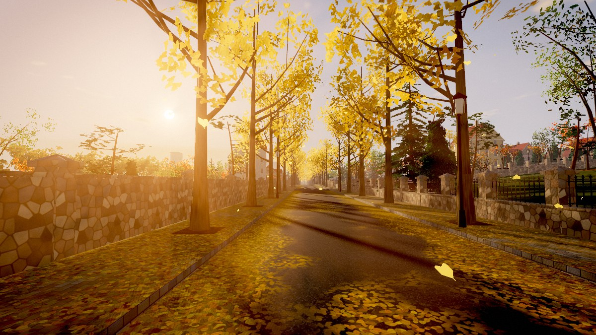
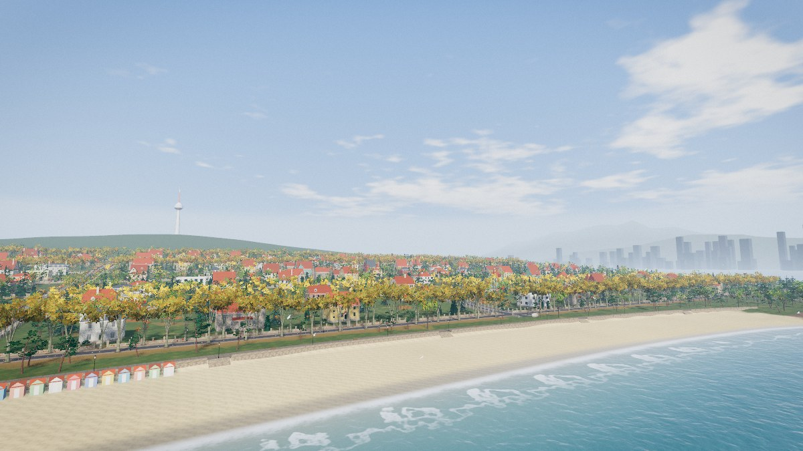
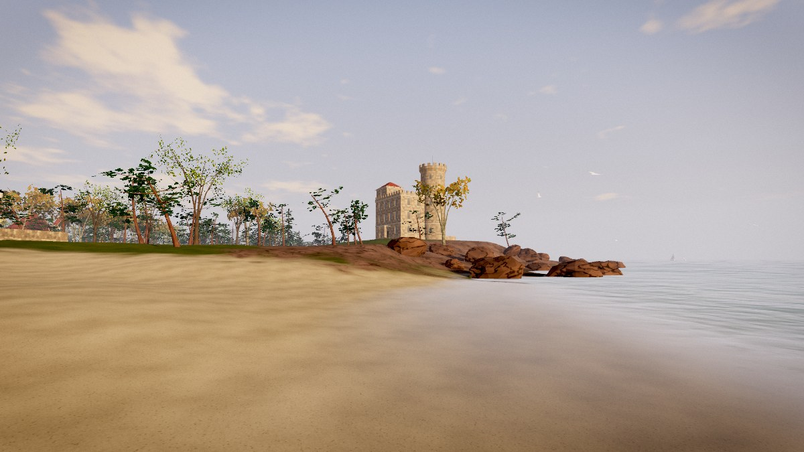
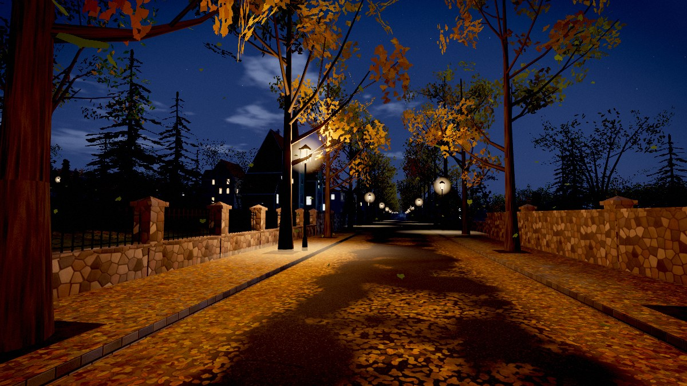
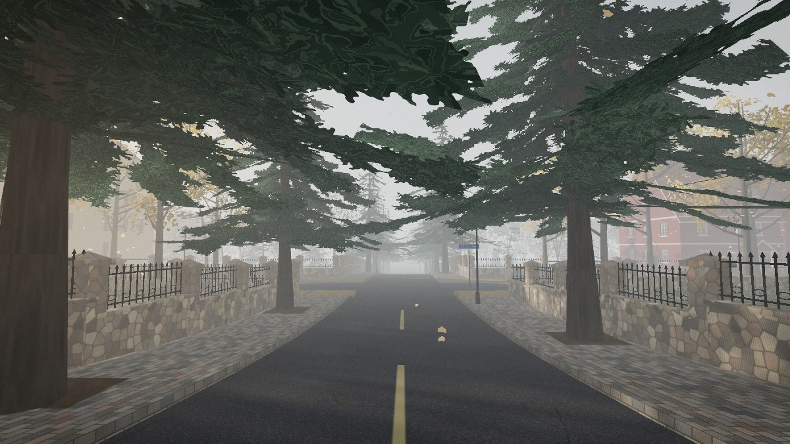

# 青島 · 八大關

一座可以自由漫步的 three.js 互動景觀——**紅瓦綠樹，碧海藍天**；十條以關隘為名的馬路，**一關一樹，一路一景**。

> An explorable, fully procedural three.js landscape of Badaguan ("Eight Great Passes"), the
> historic villa district on the shore of Taiping Bay in Qingdao, China. No image, model or
> audio assets — every texture, tree, villa and sound is generated in the browser.



| 晴午 · 太平灣與第二海水浴場 | 斜陽 · 花石樓 |
| --- | --- |
|  |  |
| **華燈夜色 · 居庸關路** | **晨霧 · 紫荊關路的雪松** |
|  |  |

<sub>以上皆為場景內的實際畫面（`tools/shot.mjs` 擷取）。另見：[春天的韶關路碧桃](docs/06-spring-peach.jpg)、[晴午的雪松大道](docs/07-cedar-avenue.jpg)。</sub>

## 開啟方式

不需要建置，也不需要伺服器：

```bash
# 方式一：直接用瀏覽器開啟（已附建置好的 dist/app.js）
open index.html            # macOS；Windows / Linux 直接雙擊 index.html 亦可

# 方式二：本機預覽伺服器（只綁定 127.0.0.1）
npm install
npm start                  # → http://127.0.0.1:5173/
```

建議使用桌面版 Chrome / Edge / Firefox / Safari（需 WebGL 2）。畫質會依機器效能自動調整，也可在右上角手動切換。

## 操作

| 按鍵 | 動作 |
| --- | --- |
| `W` `A` `S` `D` / 方向鍵 | 移動 |
| 滑鼠（點擊畫面鎖定） | 環顧；`Esc` 釋放滑鼠 |
| `Shift` | 快走／飛行加速 |
| `Space` | 跳躍（飛行時上升） |
| `F` | 步行 ↔ 飛行（飛行時 `E` 升、`Q` 降） |
| `1` `2` `3` `4` | 晨霧 · 晴午 · 金秋斜陽 · 華燈夜色 |
| `[` `]` | 切換四季（春 · 夏 · 秋 · 冬） |
| `T` | 自動導覽（再按一次由你接手） |
| `M` | 「一關一樹」大地圖——點任一處即可前往 |
| `N` / `P` / `H` | 環境聲 / 隱藏介面拍照 / 操作說明 |

觸控裝置：左下搖桿移動，右側拖曳環顧。

## 場景裡有什麼

**依實地格局**（約 0.6 倍濃縮）：南北向三條——韶關路、寧武關路、紫荊關路；東西向七條——武勝關路、嘉峪關路、函谷關路、正陽關路、臨淮關路、居庸關路、山海關路；再加上沿海的黃海路繞過太平角。

**一關一樹**（行道樹與實地一致）：

| 道路 | 行道樹 | 最美的時候 |
| --- | --- | --- |
| 居庸關路 | 銀杏 | 深秋一路金黃 |
| 嘉峪關路 | 五角楓 | 霜染楓紅 |
| 紫荊關路 | 雪松 | 四季常青 |
| 韶關路 | 碧桃 | 春來粉紅如帶 |
| 寧武關路 | 海棠 | 春花秋實 |
| 正陽關路 | 紫薇 | 盛夏百日紅 |
| 臨淮關路 | 龍柏 | 蒼翠挺拔 |
| 山海關路 · 武勝關路 · 函谷關路 | 法國梧桐 | 老樹夾道 |
| 黃海路 · 太平角 | 黑松 | 礁石濤聲 |

**地標**：太平灣岬角上的花崗岩古堡 **花石樓**（圓塔、雉堞、多角形陽台）；居庸關路上藍綠牆、紅瓦尖塔的 **公主樓**；弧形的 **第二海水浴場**與彩色更衣小屋；**太平角**的礁石、迎風傾斜的黑松與觀海木平台；刻著「八大关」的景石。

**萬國建築**：一百三十餘棟別墅由程式逐棟生成，分八種風格（德式半折坡屋頂、都鐸半木構、西班牙拱廊、法式孟莎屋頂、北歐尖頂、殖民式柱廊、1930 年代摩登圓角、花崗石砌），花崗岩蘑菇石牆基與院牆、鐵藝欄杆、牆上轉紅的爬山虎。

**氛圍**：

- 四個時辰：海霧瀰漫的清晨、碧海藍天的晴午、銀杏逆光的金秋斜陽、華燈初上的夜色（路燈、窗燈、對岸浮山灣的城市天際線、太平山電視塔的航空警示燈）。
- 四季：春天韶關路的碧桃與寧武關路的海棠、夏天正陽關路的紫薇、秋天的銀杏與楓、冬天落盡葉子的枝椏與常青的雪松。
- 隨風搖曳、逆光透亮的樹葉；飄落的銀杏葉與「落葉緩掃」的滿地金黃；樹影斑駁的柏油路。
- 會呼吸的海：湧浪、浪花、濕沙倒映天光、波光粼粼的日（月）徑；海鷗盤旋、帆船點點。
- 以高度霧與大氣透視統一遠近，逆光時的光束（god rays）、泛光、膠片色調與顆粒。
- 以 WebAudio 即時合成的環境聲：潮聲、風過樹梢、海鷗、踩在落葉上的腳步聲，霧天還有遠處的霧號。

## 技術摘要

- [three.js](https://threejs.org/) r187（WebGL 2），esbuild 打包成單一 `dist/app.js`，因此可直接以 `file://` 開啟。
- 全程序化：地形、貼圖（Canvas 繪製並推導法線貼圖）、樹木骨架與葉片卡、別墅、道路、聲音，皆於載入時生成（約數秒）。
- 光影：`SunLight` 兩級聯級陰影（CSM）、半球天光；所有材質共用一套注入式的高度霧 / 大氣透視著色器，遠景與地平線顏色完全一致。
- 植被：三十餘萬張葉片卡以 `InstancedMesh` 依街區分塊繪製（可被視錐與陰影級聯剔除），頂點著色器處理風動、季節疏密與遠距 LOD；樹幹以 `BatchedMesh` 逐棵剔除。
- 後製：HDR 渲染目標 + MSAA → 放射狀光束 → 漸進式泛光 → ACES 色調映射、調色、暗角、顆粒。
- 互動：Pointer Lock 第一人稱、貼地行走與碰撞（牆、屋、樹幹）、飛行模式、觸控搖桿、Catmull-Rom 導覽路徑。

```
src/
  main.js              進入點、載入流程、畫質自適應
  core/                數學 / 雜訊、幾何建構器、程序化貼圖
  world/layout.js      海岸線、地勢、路網、地塊與別墅位置（單一事實來源）
  world/atmosphere.js  時辰預設、共用霧與天空著色器
  world/{sky,ocean,terrain,roads}.js
  world/{trees,planting}.js   樹種生成與「一關一樹」栽植
  world/buildings.js   別墅生成器、花石樓、公主樓
  world/{props,backdrop,life}.js  石牆街燈長椅 / 遠景天際線 / 落葉海鷗帆船
  fx/post.js           後製管線
  player/              第一人稱控制、導覽
  ui/hud.js            介面與地圖
  audio/ambient.js     合成環境聲
tools/build.mjs        esbuild 建置 / 預覽伺服器
tools/shot.mjs         無頭瀏覽器截圖（開發用）
```

## 開發

```bash
npm run dev      # 監看 + 預覽（127.0.0.1:5173）
npm run build    # 產生 dist/app.js
```

```bash
node tools/smoke.mjs                       # 互動冒煙測試（無頭瀏覽器，25 項檢查）
node tools/shot.mjs out '[{"name":"a","cam":[62,0,67.6,268,3],"walk":true,"preset":"golden"}]'
```

兩支工具需要 `playwright-core`（已列於 devDependencies）與一個 Chromium / Chrome，可用環境變數 `CHROME_PATH` 指定執行檔。

網址參數（除錯用）：`?q=low|medium|high`、`?preset=dawn|noon|golden|night`、`?season=0..3`、`?cam=x,y,z,heading,pitch`、`?fps`。

## 關於「真實」

場景以八大關的真實格局、行道樹配置、地標與建築語彙為本，並把今天（十一月上旬，銀杏與楓葉最盛的時節）設為預設。但它是一幅**濃縮的藝術再現**，並非測繪等級的地圖：街區尺度約為實地的六成，除花石樓與公主樓外，別墅皆為依當地風格生成、並不對應特定門牌。

## 第三方

[three.js](https://github.com/mrdoob/three.js)（MIT 授權）隨 `dist/app.js` 一併打包，其授權聲明保留於檔案結尾。除此之外沒有任何外部素材。
